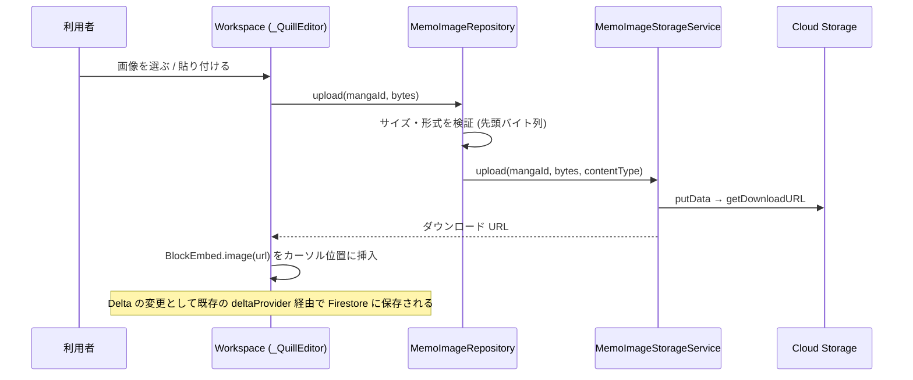

# Design: アイデアメモの画像

## 前提
- Requirements: [requirements.md](./requirements.md)
- データの置き場所・制約・旧クライアント互換は [data-model.md の「メモの画像」](../../../design/data-model.md#メモの画像) を正とする

## 構成



- データ層: `MemoImageStorageService` (Cloud Storage、`FirebaseException` → `FirebaseServiceException`) と
  `MemoImageRepository` (検証と `RepositoryException` への変換)。`MangaRepository` には足さない
  (Firestore を扱う責務と分け、既存テストの組み立てを変えないため)
- 貼り付け: flutter_quill の `QuillClipboardConfig.onImagePaste` を使う。
  クリップボードからの画像の取り出しと挿入は flutter_quill が行う。
  アイデアメモでは `enableExternalRichPaste: false` にする。HTML の貼り付けが先に試されると、
  ブラウザでコピーした画像が保存されずに元サイトの URL (や data URI) のまま入るため
- ボタンで追加した画像は、メモにフォーカスがあればカーソル位置、なければ末尾に入れる
- ファイル選択: `file_selector` の `openFile`。Web / iOS / Android で同じ API
- 表示: `MemoImageEmbedBuilder` (key = `image`)。Web では Storage バケットに CORS を設定していないので
  `Image.network` の `webHtmlElementStrategy: fallback` で `` 要素に任せる
- 未知の embed: `UnknownEmbedBuilder` をアイデアメモとページ側のエディタの両方に渡す
- 削除: `MangaNotifier.delete` が `MangaRepository.deleteManga` の後に
  `MemoImageRepository.deleteAllForManga` を呼ぶ

## API

```dart
class MemoImageRepository {
  static const maxBytes = 10 * 1024 * 1024;
  Future<String> upload(MangaId mangaId, Uint8List bytes);
  Future<void> deleteAllForManga(MangaId mangaId); // 失敗はログのみ
}
String? detectImageContentType(Uint8List bytes);
```

## エラー設計

| ケース | 検出箇所 | 振る舞い |
|---|---|---|
| 10 MB 超 | Repository | `MemoImageTooLargeException` → SnackBar |
| 非対応形式 | Repository | `UnsupportedMemoImageException` → SnackBar |
| 保存失敗 (通信・ルール拒否) | Service → Repository | `StorageException` → SnackBar |
| 画像の読み込み失敗 | `MemoImageEmbedBuilder` | その位置に代替表示 |
| 画像の一括削除失敗 | Repository | ログのみ。作品の削除は完了 |

## セキュリティ

[storage.rules](../../../../storage.rules): `users/{userId}/...` は本人のみ読み取り・削除・作成。
作成は 10 MB 以下かつ `image/(png|jpeg|gif|webp)` に限り、上書き (update) は許可しない。

## テスト戦略

- ユニット: `MemoImageRepository` (形式判定・上限・例外変換・削除失敗を飲み込む)
- 手動: dev プレビューで AC-1.1〜1.6, AC-2.1 を確認 (Storage と Quill のクリップボードは自動テストで再現しにくい)

## 既存仕様への影響

- Firestore のスキーマ変更なし。Delta の中身に画像 embed が入りうるようになる
- 1.0.4+5 以前のクライアントは画像入りメモで落ちるため、最小バージョンゲートの引き上げが必要
- Cloud Storage の有効化 (Blaze プラン) と `storage.rules` のデプロイが dev / prod それぞれに必要

## 代替案 (Alternatives Considered)

- Firestore に縮小画像を base64 で保存 — プラン変更は不要だが 1 ドキュメント 1 MB 上限で画質が落ちる
- Cloudflare R2 + Worker — Firebase ID トークンの検証を自前で書く必要があり、静的配信のみの構成を崩す
- 独自 embed 型 (Storage のパスを持つ) — URL の有効期限を気にしなくてよいが、表示のたびに URL 解決が要る。
  ダウンロード URL はトークンを失効させない限り使い続けられるので標準の `image` を採用
