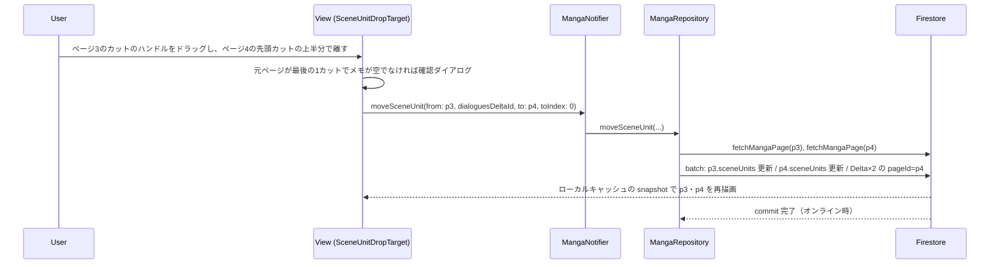
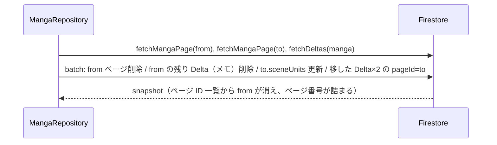

# Design: ページとカットの並べ替え

## 設計サマリ

編集画面のページリストを `ReorderableListView` から通常の `ListView` に置き換え、ページのドラッグをなくす。
空いたドラッグ操作をカットに割り当て、Flutter 標準の `Draggable` / `DragTarget` で
**カットのハンドル → カットの上半分（前へ挿入）／下半分（後ろへ挿入）** へのドラッグを組む。
受け皿はすべてのページのカットに置くので、同じページ内の並べ替えとページをまたぐ移動を同じ仕組みで扱える。

ページをまたぐ移動は、Repository に `moveSceneUnit` を足し、次の書き込みを **1 つの `WriteBatch`** にまとめる。

- 元ページの `sceneUnits` から取り除く（最後の 1 カットならページごと削除し、残りの Delta（メモ）も削除）
- 移動先ページの `sceneUnits` の指定位置へ挿入
- 移したカットの Delta 2 件の `pageId` を移動先ページに書き換え

`pageId` の書き換えが要るのは、`deleteMangaPage` が Delta を `pageId` で集めて削除するため。
書き換えないと、元ページを削除したときに移したカットのセリフ・ト書きまで消える。

ページの並べ替えは、各ページのツールバーに「︙」メニューを置き、既存の `MangaNotifier.reorderPage` を呼ぶ。
スキーマは変えない（`CloudDelta.pageId` の値を更新するだけ）。

## アーキテクチャ上の位置づけ

参照: [docs/design/architecture.md](../../../design/architecture.md)

| レイヤー | この機能の追加・変更点 |
|---|---|
| UI (`lib/feature/manga/view/`) | `manga_page_list.dart`: `ListView` 化、ページごとの `GlobalKey`、ドラッグ中の自動スクロール。`scene_unit_drag.dart`: カットのハンドル・受け皿・自動スクロール。`page_menu_button.dart`: ページの「︙」メニュー。`manga_page_widget.dart`: それらの組み込みとメモ削除の確認ダイアログ |
| State (`provider/manga_providers.dart`) | `MangaNotifier.moveSceneUnit` を追加。ページの前後移動は既存の `reorderPage` を使う |
| Repository | `MangaRepository.moveSceneUnit` を追加。同じページなら既存の `reorderSceneUnit` と同じ処理 |
| Service | `FirebaseBatchWrapper` に `updateDelta` / `deletePage` / `deleteDelta` を追加 |
| Backend | スキーマ変更なし。`firestore.rules` 変更なし（`users/{uid}` 配下は本人が読み書き可） |

## データモデル

参照: [docs/design/data-model.md](../../../design/data-model.md)

モデルの形は変えない。意味づけを 1 点はっきりさせる。

| フィールド | 意味 |
|---|---|
| `CloudDelta.pageId` | その Delta が**現在**所属するページ。カットがページを移ると書き換わる |

`schemaVersion` は据え置き。フィールドの追加・削除・形の変更がなく、旧クライアントも書き換え後の値をそのまま読めるため。

## 主要フロー

### カットを別のページへ移す（golden path）



### 元ページの最後の 1 カットを移す



## 主要 API / インターフェース

```dart
// MangaRepository
/// 移すカットは位置ではなくセリフの DeltaId で探す（ドラッグ中に元ページのカットが増減しても別のカットを動かさない）。
/// 見つからなければ何もしない。
/// [toIndex] は移動先ページの、挿入前の sceneUnits に対する挿入位置 (0..length)。
/// fromPageId == toPageId のときは、取り除いた後のリストに対する位置に読み替えて reorderSceneUnit と同じ処理をする。
/// 戻り値は元ページを削除したかどうか。
Future<bool> moveSceneUnit({
  required MangaId mangaId,
  required MangaPageId fromPageId,
  required DeltaId dialoguesDeltaId,
  required MangaPageId toPageId,
  required int toIndex,
});

// FirebaseBatchWrapper
void updateDelta(String mangaId, String deltaId, Map<String, dynamic> updates);
void deletePage(String mangaId, String pageId);
void deleteDelta(String mangaId, String deltaId);

// MangaNotifier
/// 並びが変わったかを返す（端を越える移動は何もしない）
Future<bool> movePage(MangaPageId pageId, int offset);
Future<void> moveSceneUnit({
  required MangaPageId fromPageId,
  required DeltaId dialoguesDeltaId,
  required MangaPageId toPageId,
  required int toIndex,
});
```

### UI の部品

| 部品 | 役割 |
|---|---|
| `SceneUnitDragData` | ドラッグで運ぶ値。元ページの ID・番号・カット数・メモの DeltaId と、カットの index・セリフの DeltaId |
| `SceneUnitDragHandle` | `_SceneUnitWidget` の右列（「︙」の上）に `Icons.drag_indicator`。`Draggable<SceneUnitDragData>` で包む。テキスト欄は包まないので範囲選択と衝突しない (AC-1.6) |
| `SceneUnitDropTarget` | 各カットを包む `DragTarget`。ポインタが上半分なら index、下半分なら index+1 を挿入位置とし、ホバー中だけカットの上端／下端に挿入線を出す (AC-1.3)。カットの間の余白で離したときは何もしない |
| ドラッグ中の見た目 | `feedback` はセリフ先頭 1 行を出す幅固定の小さなカード。元のカットは全体を薄く表示 |
| ページの「︙」メニュー (`page_menu_button.dart`) | `PageAction { moveBackward, moveForward, delete }`。デスクトップ・モバイル両方のツールバーに置き、ゴミ箱アイコンを置き換える |

### 挿入位置から移動先の index への変換

挿入位置 `s`（0..n）と元の位置 `o` から決める。UI 側の判定は純粋関数 `sceneUnitDropIndex` にして単体テストする。

| 条件 | 結果 |
|---|---|
| 同じページで `s == o` または `s == o + 1` | 移動しない (AC-1.5)。挿入線も出さない |
| 同じページでそれ以外 | `moveSceneUnit(toIndex: s)`。Repository が `reorderSceneUnit(o, s > o ? s - 1 : s)` に読み替える |
| 別のページ | `moveSceneUnit(toIndex: s)` |

### ドラッグ中の自動スクロール

`EdgeAutoScroller` が、表示領域の上下端から 48px 以内にポインタがある間、近さに応じた速さでスクロールし続ける (AC-2.2)。

- ページリスト: リスト全体を包む `CutDragScope` の `Listener` がポインタの移動を受け、カットのドラッグ中だけスクロールする。
  ドラッグ元のカットはスクロールで画面外に出ると破棄され、`Draggable` のコールバックが届かなくなるため、
  ポインタを押した時点の祖先である `Listener` で受け、ポインタを離したら必ず止める
- ページ内のカット欄（高さ固定の `SingleChildScrollView`）: ポインタの下にある `SceneUnitDropTarget` の `onMove` で、
  そのカット欄をスクロールする。受け皿から離れる・落とすと止める

## 状態遷移 / ライフサイクル

保存の流れは既存のカット操作と同じ。`WriteBatch.commit()` はローカルキャッシュへ即座に反映され、
snapshot 経由で画面が先に更新される (NFR-001)。オフラインでもキューに積まれ、再接続時に送られる (NFR-002)。
UI は commit の完了を待たずに操作を終え、失敗時だけ `catchError` で SnackBar を出す。
サーバーが書き込みを拒否した場合は、Firestore が latency compensation を取り消し、snapshot が保存済みの並びに戻る (FR-002)。

## エラー / 例外設計

| ケース | 検出箇所 | 振る舞い |
|---|---|---|
| 元・移動先ページが見つからない（ドラッグ中に別端末で削除） | Repository | `NotFoundException`。UI で「移動できませんでした」SnackBar |
| index が範囲外（ドラッグ中に別端末でカットが減った） | Repository | 何もしない（既存の `reorderSceneUnit` と同じ） |
| commit 失敗 | Repository → UI | `_handleFirebaseException` で変換して投げ、UI で SnackBar |
| 元ページの最後のカットでメモが空でない | UI | 確認ダイアログ。キャンセルなら Notifier を呼ばない (AC-2.6) |

### 同時編集について

`sceneUnits` は順序つきの配列なので `arrayUnion` / `arrayRemove` では表せず、既存のカット操作と同じく
読み込み → 書き換えで更新する。編集ロック (`LockManager`) は現状どこからも使われていないため、
2 端末で同じページのカットを同時に動かすと後勝ちになる。これは既存の `reorderSceneUnit` / `addSceneUnit` と同じ制約として受け入れる。

## テスト戦略

- ユニット（data パッケージ、`test/repository/manga_repository_scene_unit_test.dart` に追加）
  - 同じページ内: `reorderSceneUnit` と同じ結果になる
  - 別のページ: 元から消え、移動先の指定位置に入り、Delta 2 件の `pageId` が移動先になる。1 回の batch commit で行われる
  - 元ページの最後のカット: ページ削除、メモ Delta 削除、移した Delta は削除されない、戻り値 `true`
  - ページが見つからない: `NotFoundException`。index 範囲外: 何も書かない
- ユニット（root）: 挿入位置 → 移動先 index の変換関数、`MangaNotifier.moveSceneUnit` が Repository に委譲すること、
  `MangaNotifier.movePage` が最新の並びに対して前後へ動かし、端を越えないこと
- ウィジェット
  - `PageMenuButton`: 先頭は「前へ」、末尾は「次へ」が無効。選んだ項目に応じた移動量・削除を伝える
  - `MangaPageList` をデスクトップ幅で組み、Fake の Repository で: 同じページ内・別ページへのドラッグ、
    元の位置の前後に落としたときは移動しない、メモありの確認ダイアログ（キャンセル／実行）、メモなしは確認しない、
    ページの「︙」メニューで次へ移動・ゴミ箱アイコンがない、ドラッグ中のリスト下端での自動スクロール
- 手動（Web とデスクトップ）
  - 同じページ内のドラッグ、別のページへのドラッグ、画面外のページへの自動スクロール
  - テキスト欄内のドラッグで範囲選択になりカットが動かない
  - 最後の 1 カットを移したときのページ削除とページ番号の詰まり、メモありの確認ダイアログ
  - 移したカットのセリフが「セリフをコピー」とページ一覧表示に出る。その後に移動先ページを削除すると一緒に消える

## 既存仕様への影響

- データ移行なし。既存データの Delta の `pageId` は正しいページを指したまま
- 旧クライアントは `pageId` が書き換わった Delta をそのまま読める。旧クライアントでページを削除しても、
  `pageId` で集めて消すので新クライアントと同じ結果になる
- [data-model.md](../../../design/data-model.md) の `CloudDelta.pageId` の説明を「現在所属するページ」に更新する
- ページ削除で `pageIndex` に欠番ができるため、新しいページの `pageIndex` はページ数ではなく既存の最大値 + 1 にする（同じ値が重なると並びが崩れる）
- 編集画面のページリストからページのドラッグがなくなる。CHANGELOG の「変更」に書く

## 代替案 (Alternatives Considered)

- **Firestore transaction で移動する** — 同時編集に強いが、オフラインでは失敗する。NFR-002 を満たせないので採用しない
- **ページ削除を「ページが参照する Delta を消す」方式に変え、`pageId` を書き換えない** — `deleteMangaPage` の振る舞いが変わり、
  旧クライアントは `pageId` で消すため、旧クライアントでページを消すと移したカットが消える。採用しない
- **ページごとの `ReorderableListView` でカットを並べ替える** — ページをまたげない。採用しない
- **ドラッグ＆ドロップのパッケージ（`super_drag_and_drop` など）を入れる** — OS 間のドラッグは不要で、標準の `Draggable` で足りる。採用しない
